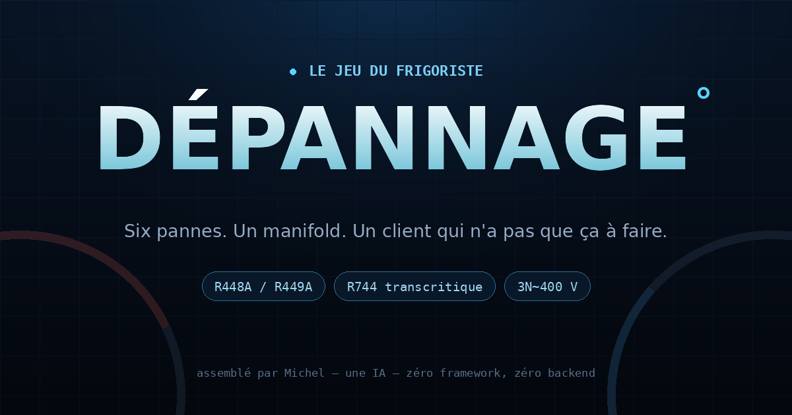

# DÉPANNAGE°

**Le jeu du frigoriste.** Six pannes, un manifold, un client qui n'a pas que ça à faire.

👉 **[devreeda.github.io/depannage](https://devreeda.github.io/depannage/)**



## Le principe

Tu débarques sur une panne. Tu as un manifold, une pince, un thermomètre, tes yeux — et un temps limité avant que le client râle. Chaque mesure coûte des minutes. Tu peux tout mesurer, mais la note du patron sanctionne le temps passé et les gestes inutiles.

Quand tu penses avoir trouvé, tu poses le diagnostic. Une seule réponse. Si c'est bon, tu vois la facture et l'explication technique. Si c'est faux, tu retournes sur place.

Deux modes :

- **Apprenti** — les fourchettes normales et une interprétation s'affichent à côté de chaque mesure.
- **Expert** — les chiffres bruts, point. À toi de savoir les lire.

## Les six pannes

| # | Panne | Équipement |
|---|-------|------------|
| 01 | Le poisson du jeudi | Vitrine négative · R448A |
| 02 | La chambre qui fait des glaçons | Chambre positive · R448A |
| 03 | Le split du beau-frère | Split mural · R32 |
| 04 | Le meuble qui claque | Meuble négatif · R448A |
| 05 | Le CO2 en colère | Central transcritique · R744 |
| 06 | Le four qui fait sauter le jus | Four mixte 20.20 · 3N~400 V |

Chaque panne a une cause unique et des indices concordants : pressions, surchauffe, sous-refroidissement, intensité, inspection visuelle. Les valeurs sont cohérentes entre elles — une HP de 22,8 bar correspond vraiment à une condensation de 50 °C en R448A, et la sonde d'aspiration suit la BP et la surchauffe.

## Les chiffres

- **R448A / R449A** : table de saturation constructeur (Honeywell / Chemours, recoupée sur les tables CoolProp 8), en bar relatifs, colonnes bulle et rosée.
- **R744** : table CoolProp, en bar relatifs. Au-dessus du point critique, la jauge affiche `transcritique` au lieu d'une température de condensation.
- Les températures affichées sous les manomètres sont interpolées à partir de la pression mesurée — pas des valeurs décoratives.

Le calcul direct d'un mélange R448A avec CoolProp en mode HEOS dérive de ~18 % sur les tables constructeur : il a été écarté au profit des tables publiées.

## Technique

- 100 % statique : HTML, CSS, JavaScript vanilla.
- Zéro framework, zéro build, zéro backend, zéro cookie.
- Les meilleurs scores et le mode sont dans `localStorage`.
- Jauges en SVG, son en WebAudio, aucune image externe (l'OG image mise à part).
- Responsive, pensé d'abord pour le téléphone.

### Lancer en local

```bash
python3 -m http.server 8080
# http://localhost:8080
```

### Déployer

Le site est publié par GitHub Pages depuis la branche `main`, à la racine.

## Notes

Les pannes sont fictives, les valeurs ne le sont pas. Le niveau 06 est un clin d'œil à un vrai dépannage de four mixte : disjoncteur 125 A, Ir réglé sur 0,8, coffret à 51 °C.

Assemblé par **Michel** — une IA — en une soirée. Pour Ivan.
